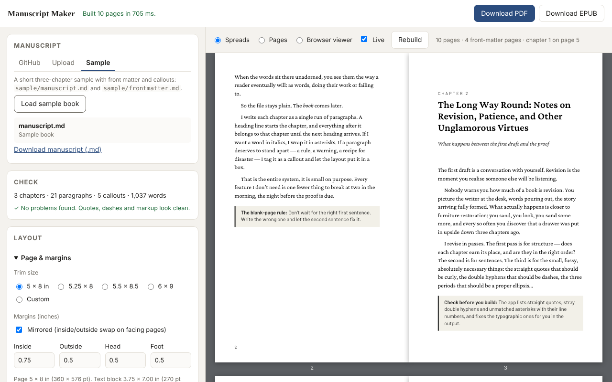

# Manuscript Maker

**Write your book as plain text in a private Git repo. Build a print-ready PDF or an EPUB whenever you want.**

Manuscript Maker is a small, static web app (plus a command-line tool) that turns a simple text manuscript into a properly typeset book:

- mirrored margins, right-hand chapter openers and roman/arabic page numbers
- a line breaker that handles hyphens and dashes, with widow and orphan control
- callout boxes and front matter
- a clean EPUB 3 from the same source

There is no server and no account. The app runs entirely in your browser, and your manuscript only travels between your browser and GitHub.



---

## Contents

- [Quick start](#quick-start)
- [Setting up your writing repo](#setting-up-your-writing-repo)
- [Manuscript format](#manuscript-format)
- [Front matter format](#front-matter-format)
- [Layout settings and `book.json`](#layout-settings-and-bookjson)
- [Importing Word, EPUB and Markdown](#importing-word-epub-and-markdown)
- [Command line and GitHub Actions](#command-line-and-github-actions)
- [Default layout](#default-layout)
- [Privacy](#privacy)
- [Development](#development)
- [License](#license)

---

## Quick start

### Use it on GitHub Pages

1. Fork or clone this repository.
2. Go to **Settings → Pages**, choose **Deploy from a branch**, then **main** and **/ (root)**.
3. Open `https://<your-username>.github.io/manuscript-maker/`.

### Or run it locally

```sh
git clone https://github.com/ei9h7/manuscript-maker
cd manuscript-maker
npm install
npm run serve          # http://localhost:8080
```

To see it work, open the **Sample** tab and click **Load sample book**. The sample is three short chapters with front matter, in `sample/`.

---

## Setting up your writing repo

**The quick way:** open [**manuscript-template**](https://github.com/ei9h7/manuscript-template), click **Use this template → Create a new repository**, name it after the book, and choose **Private**. You get the files below, the sample book to write over, and the build action, ready to go.

Use one repository per book. For many short works, one repository with a folder per work (`stories/manuscript.md`, …) also works. Branches are best kept for versions of the same book.

Keep the book in its own **private** repository:

```
my-book/
├── manuscript.md      ← the chapters (required)
├── frontmatter.md     ← half title, title page, praise, copyright… (optional)
└── book.json          ← layout overrides (optional)
```

The manuscript can also be a folder of chapter files. Point the app at the folder, and every `.md` file in it is joined in name order (`01-start.md`, `02-middle.md`, …).

To let the app read the private repo:

1. Create a **[fine-grained personal access token](https://github.com/settings/personal-access-tokens/new)**:
   - **Repository access:** *Only select repositories* → your writing repo
   - **Permissions:** *Contents* → **Read-only**
2. In the app, open the **GitHub** tab and enter `owner/my-book`, the path (`manuscript.md`), an optional branch, and the token.
3. Click **Load from GitHub**. `book.json` and `frontmatter.md` next to the manuscript are loaded too.

The token is sent only to `api.github.com`. It is kept for the browser session, or in this browser's local storage if you tick *Remember token*.

---

## Manuscript format

```
## 1|Starting with a Blank Page|Why every book begins as a plain text file
Each line is one paragraph. Blank lines are ignored.
[!callout] A paragraph that starts like this is set in a callout box.
*Italic*, _italic_ and **bold** work inline. Write \* for a literal asterisk.
```

| Line | Meaning |
|---|---|
| `## n\|Title\|Subtitle` | Starts a chapter. The subtitle is optional. `## Title` with no number gets the next number. |
| `[!callout] …` | A callout box. A short `Label:` at the start is set in bold. |
| anything else | A body paragraph |
| `\##`, `\[!callout]` | A literal `#` or `[` at the start of a paragraph |

**Typography check.** The *Check* panel lists problems with line numbers:

- straight quotes (`"` `'`), `--` and `...`
- double spaces, stray HTML and unmatched `*`

By default, quotes, dashes and ellipses are converted to `“ ” ‘ ’`, `—` and `…` in the output, so the source can stay simple. Everything is escaped properly in the EPUB, so `&`, `<` and `>` in your text are safe.

---

## Front matter format

The pages before chapter 1 live in `frontmatter.md`. They can also go at the top of the manuscript, before the first `##` chapter.

```
year: 2026

[halftitle]

[praise]
heading: Praise for {title}
A small book about making books, exactly the right size for the job. — The Sample Review

[title]
title: Notes from the Margin
subtitle: A short sample book for Manuscript Maker
author: A. N. Author

[copyright]
Copyright © {year} {author}
All rights reserved.

No part of this book may be reproduced without permission.
```

- **`[type]` starts a page.** Pages print in the order listed.

  | Page | What it holds |
  |---|---|
  | `[halftitle]` | the book title only |
  | `[title]` | title, subtitle, author, publisher |
  | `[praise]` | blurbs, each followed by ` — Source` |
  | `[copyright]` | small type set at the foot of the page; a blank line starts a new group |
  | `[dedication]` | centred italic lines |
  | `[epigraph]` | a quotation, ` — Source` |
  | `[page]` | any `heading:` plus paragraphs (`align: center` optional) |
  | `[blank]` | an empty page |
  | `[toc]` | where the contents page goes (when enabled) |

- **`key: value` lines** right after the bracket set that page's fields: `title`, `subtitle`, `author`, `publisher`, `heading`, `align`.
- **Every other line** is one paragraph.
- **Book-wide values** go above the first page: `year`, `isbn`, `publisher`, `language`, `identifier`, and `cover` (an image in the repo, e.g. `cover: cover.jpg`, used as the EPUB cover).
- **One output only:** add `.print` or `.epub` to a key, e.g. `subtitle.epub: …` for a version used only in the EPUB.
- **Placeholders** `{title}`, `{subtitle}`, `{author}`, `{year}`, `{publisher}` and `{isbn}` are filled in anywhere.
- **`//`** starts a comment line.

Display text on these pages is **content-aware**. A heading that almost fits on one line is set slightly smaller so it does. Longer ones keep their size and get balanced lines, so no word is left on its own. The title and author also become the PDF and EPUB metadata.

In the web app the front matter is an editable box in the *Front matter* section. It rebuilds the preview as you type, and **Download frontmatter.md** saves it for your repo.

---

## Layout settings and `book.json`

Every layout choice is in the form on the left:

- trim size and margins (mirrored or not)
- chapters on the right-hand page
- roman front matter numbers
- page number position
- running heads
- fonts and sizes for chapter label, title, subtitle, body and callout
- leading, paragraph gap and indent; ragged or justified
- widow and orphan control, and hyphen breaks
- callout style (box or plain)
- chapter opener style
- contents page
- text clean-up and EPUB options

To keep your settings with the book, click **Download book.json** and commit the file next to the manuscript. It contains only what differs from the defaults:

```json
{
  "toc": { "enabled": true },
  "opener": { "align": "center" },
  "input": { "calloutPattern": "^Rule \\d+:" }
}
```

`input.calloutPattern` is a regular expression. Every paragraph that matches it becomes a callout, without adding `[!callout]` to the text. See `src/settings.js` for every key.

---

## Importing Word, EPUB and Markdown

Use the **Upload** tab:

| File | What happens |
|---|---|
| `.md` / `.txt` | Used as-is if it is already in the manuscript format. Ordinary Markdown is converted: `#`/`##` headings become chapters, wrapped paragraphs are joined, `>` quotes become callouts, links and images are removed. |
| `.docx` | Heading 1/2 become chapters, the *Subtitle* style becomes the subtitle, the *Quote* style becomes a callout, and italic/bold are kept. |
| `.epub` | Chapters are read in reading order. The table of contents, navigation, `toc.ncx`, cover, title and copyright pages are **removed**, which gives you a clean transcript for the print edition. |
| front-matter file | A `.md` that starts with a `[page]` line goes into the front-matter box. |

After an import, **Download manuscript (.md)** saves the converted text, ready to commit.

---

## Command line and GitHub Actions

```sh
npm install
node bin/build.mjs path/to/manuscript.md --pdf out/book.pdf --epub out/book.epub
```

- `book.json` and `frontmatter.md` next to the manuscript are picked up automatically. Use `--config` and `--front` to point elsewhere.
- `--no-fonts` skips the font download and uses Times.
- `npm run build:sample` builds the sample into `dist/`.

To build the book from GitHub with no browser, use the workflow that comes with the template. In an existing repo, copy [`templates/build-book.yml`](templates/build-book.yml) to `.github/workflows/build-book.yml`.

- **Actions → Build book → Run workflow** attaches the PDF and EPUB to the run.
- Pushing a tag like `v1.0` also attaches them to a GitHub Release, so every proof is kept.

---

## Default layout

| | |
|---|---|
| Trim | 5 × 8 in (360 × 576 pt) |
| Margins | mirrored: inside 0.75 in, outside 0.5 in, head and foot 0.5 in. The text block is 270 pt wide. |
| Body | Crimson Pro 11 pt, 15.5 pt leading, 6.5 pt between paragraphs, 12 pt first-line indent (none after a chapter heading), ragged right |
| Chapter openers | always on a right-hand page, with a blank page inserted when needed. Left-aligned `CHAPTER 1` (Barlow 8 pt, letter-spaced, grey), title (Crimson Pro Semibold 19 pt), subtitle (italic 11 pt, grey). No page number on opener pages. |
| Callouts | Barlow 9.5 pt in a tinted box with a left rule, kept on one page |
| Page numbers | front matter is counted i, ii, iii… (not printed by default). Arabic from chapter 1, in the bottom outside corner, with at least one line of space above. Blank pages are never numbered. |
| Line breaking | greedy, measured with the real font metrics. Lines break at hyphens, dashes and soft hyphens. A word too long for a whole line is split at its hyphens first. A line never starts with a spaced em dash. |
| Widows and orphans | at least two lines of a paragraph at the foot and the head of every page |
| End | a blank last page is added so the page count is even |

**Fonts.** [Crimson Pro](https://fonts.google.com/specimen/Crimson+Pro) and [Barlow](https://fonts.google.com/specimen/Barlow) are downloaded from jsDelivr when you build, and embedded in the PDF (and, optionally, the EPUB). Both fonts are licensed under the [SIL Open Font License](https://openfontlicense.org) and are not part of this repository. If the download fails, the book falls back to Times and a warning is shown.

---

## Privacy

- No backend. Everything, including PDF and EPUB generation, runs in your browser.
- The manuscript is fetched directly from `api.github.com` with your token. Nothing is sent anywhere else.
- External requests:
  - the libraries ([jsPDF](https://github.com/parallax/jsPDF), [JSZip](https://stuk.github.io/jszip/), [pdf.js](https://mozilla.github.io/pdf.js/), [mammoth.js](https://github.com/mwilliamson/mammoth.js) for Word files) and the fonts, from cdnjs and jsDelivr
  - GitHub's API

---

## Development

```
index.html, app.css      the web app
src/
  parser.js              manuscript format → chapters and blocks
  frontmatter.js         front-matter format
  text.js                smart quotes, lint, escaping, numbering
  linebreak.js           line breaker
  pdf.js                 print layout (jsPDF)
  epub.js                EPUB 3 builder
  importers.js           .md / .txt / .docx / .epub import
  github.js              loading from GitHub
  preview.js             facing-page preview (pdf.js)
  settings.js            defaults
  app.js                 UI wiring
bin/build.mjs            command-line build
sample/                  sample book
templates/               GitHub Actions workflow for a writing repo
test/                    node --test suite
```

```sh
npm test
```

### Ideas

- dictionary hyphenation (today, add soft hyphens `U+00AD` where you want breaks)
- drop caps and small-caps lead-ins
- PDF/X output for printers

---

## License

[MIT](LICENSE) © 2026 ei9h7

The sample text in `sample/` is placeholder content written for this project and may be reused freely.
